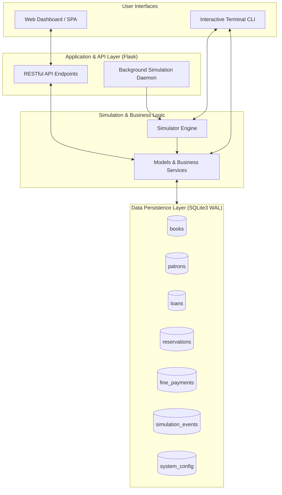

# 🏛️ Athenaeum — Database-Driven Library Management & Behavioral Simulation Platform

A full-stack, database-backed Library Management System and multi-agent operational simulator built with Python, SQLite, Flask, and an interactive modern web dashboard.

---

## 🌟 Highlights & Key Functionalities

- **🗄️ Relational SQLite Database:**
  - ACID-compliant transaction management with WAL (Write-Ahead Logging) mode and busy timeouts.
  - Foreign key constraints, checks, cascaded logic, and secondary indexes for optimized searches.
  - Tables: `books`, `patrons`, `loans`, `reservations`, `fine_payments`, `simulation_events`, `system_config`.

- **🤖 Autonomous Multi-Agent Behavioral Simulator:**
  - **Simulated Clock Engine:** Advance by single days, 1-week leaps, or 1-month cycles.
  - **Patron Behavioral Personas:**
    - 🎓 *Meticulous*: Always returns books on time or early; settles fines instantly.
    - 📖 *Typical*: Regular borrower; mostly returns on time with slight variance.
    - ⏳ *Procrastinator*: Frequently holds books past due date, accumulating minor fines.
    - 📦 *Forgetful*: High rate of overdue loans and requires administrative prompts.
  - **Autonomous Daily Lifecycle:**
    1. Daily Overdue Detection & Fine Accrual ($0.50/day).
    2. Reservation hold timeouts & expiration after 3 unclaimed days.
    3. Patron-driven returns influenced by persona probabilities.
    4. Auto-allocation of returned copies to next patrons waiting in the hold queue.
    5. Fine settlement decisions based on outstanding balances.
    6. Autonomous catalog browsing, borrowing, and reserve placement.
    7. Occasional library procurement restock for high-demand titles.
  - **Continuous Auto-Simulation Mode:** Background worker thread that advances 1 simulated day every 3 seconds for a live, living library experience.

- **📚 Core Library Management Operations:**
  - **Books Catalog:** Full CRUD, search by keyword (title, author, ISBN), category filtering, real-time stock and shelf location tracking.
  - **Patrons Registry:** Student, Faculty, and Community roles with customizable borrow quotas (3, 7, 2 books) and persona assignment.
  - **Circulation (Loans & Returns):** Single-click checkout, instant renewal, return processing with automatic late fine calculations.
  - **Holds & Reservations Queue:** Multi-patron queueing system with automatic notification and status transitions (`Pending` ➜ `Ready` ➜ `Fulfilled`).
  - **Fine Ledger & Receipts:** Financial tracking of penalty settlements with payment method auditing (Cash, Card, Online, Waived).

- **📊 Visual Dashboard & Live Analytics:**
  - Real-time KPI summary cards (Total Titles, Shelf Stock, Active Loans, Overdue Penalties, Revenue).
  - Interactive Chart.js charts: 14-Day Circulation Velocity and Genre Borrow Distribution.
  - Top 5 Borrowed Titles leaderboard.
  - Live color-coded Simulation Event Stream with instant auto-refresh.

- **📥 Data Export & Receipts:**
  - One-click CSV export for Books Catalog, Patrons Registry, and Overdue Violation Reports.

- **💻 Dual Interface:**
  - **Web SPA:** Modern responsive dashboard (Tailwind CSS, Chart.js, FontAwesome).
  - **Terminal CLI:** Interactive terminal console (`cli.py`) with ASCII tables and operational menus.

---

## 🏛️ System Architecture



---

## 📁 Project Structure

```
Library management/
├── app.py              # Flask server, background worker, REST API endpoints, CSV exports
├── database.py         # SQLite connection pool (WAL mode), schema definitions, indexes
├── models.py           # Data access layer, circulation validation, fine calculation, analytics
├── simulator.py        # Multi-agent simulation engine with patron personas & clock advancement
├── seed_data.py        # Curated seed dataset (25 classic books, 15 patrons, loan history)
├── cli.py              # Interactive terminal-based management & simulation console
├── run.py              # Unified entry point launcher (Web, CLI, Test, Seed)
├── test_system.py      # Automated unit & integration test suite (100% passing)
├── requirements.txt    # Python dependencies
├── templates/
│   └── index.html      # Single-Page Application web dashboard
└── library_system.db   # SQLite database file
```

---

## 🚀 Quick Start Guide

### 1. Prerequisites
- Python 3.10+ installed.

### 2. Installation
Install the only external dependency (Flask):
```bash
pip install -r requirements.txt
```

### 3. Running the Web Dashboard (Recommended)
Launch the web server:
```bash
python run.py
```
Or directly:
```bash
python app.py
```
Open your browser and navigate to: **`http://127.0.0.1:5000`**

### 4. Running the Terminal CLI Console
If you prefer running inside the command prompt or terminal:
```bash
python run.py --cli
```
Or directly:
```bash
python cli.py
```

### 5. Running the Automated Test Suite
Execute all unit and integration tests:
```bash
python run.py --test
```
Or:
```bash
python -m unittest test_system.py
```

### 6. Resetting the Database
To reset the database back to its fresh seed state at any time:
```bash
python run.py --seed
```
(You can also click the **Reset Scenario** button directly from the Web UI).

---

## 🔌 REST API Reference

| Endpoint | Method | Description |
|---|---|---|
| `/api/analytics/dashboard` | `GET` | Retrieve real-time KPIs and system status |
| `/api/analytics/charts` | `GET` | Aggregated datasets for Chart.js graphs |
| `/api/simulation/state` | `GET` | Current simulated date, fine rate, and recent events |
| `/api/simulation/step` | `POST` | Advance simulation by `days` (JSON `{ "days": 1 }`) |
| `/api/simulation/toggle_auto` | `POST` | Start/Pause continuous autonomous simulation thread |
| `/api/simulation/reset` | `POST` | Re-seed catalog and patrons to initial state |
| `/api/simulation/events` | `GET` | Live stream of recent simulation events |
| `/api/books` | `GET`, `POST` | Query catalog with filters or insert new title |
| `/api/books/<id>` | `GET`, `PUT`, `DELETE` | View, update, or remove title |
| `/api/categories` | `GET` | List distinct book categories |
| `/api/patrons` | `GET`, `POST` | List patrons with filters or register new member |
| `/api/patrons/<id>` | `GET`, `PUT`, `DELETE` | View member profile and active loans |
| `/api/loans` | `GET` | Query loans filtered by status (`Active`, `Overdue`, `Returned`) |
| `/api/loans/issue` | `POST` | Check out a book (`{ "book_id": 1, "patron_id": 2 }`) |
| `/api/loans/return` | `POST` | Check in a book with fine assessment (`{ "loan_id": 5 }`) |
| `/api/loans/renew` | `POST` | Extend due date by 14 days (`{ "loan_id": 5 }`) |
| `/api/reservations` | `GET`, `POST` | List holds queue or place a reservation |
| `/api/reservations/<id>/cancel` | `POST` | Cancel a pending/ready hold |
| `/api/fines` | `GET` | Retrieve financial payment receipts |
| `/api/fines/pay` | `POST` | Settle patron fine balance (`{ "patron_id": 1, "amount": 5.0 }`) |
| `/export/csv/<type>` | `GET` | Download live CSV report (`books`, `patrons`, `overdue`) |

---

## 🧪 Database Schema & Integrity Rules

- **Books:** Ensures `total_copies >= 0`, `available_copies >= 0`, and `available_copies <= total_copies`.
- **Patrons:** Strict unique Card Number & Email format; borrow limits enforced by role (Faculty: 7, Student: 3, Community: 2).
- **Fine Threshold:** Patrons with $\ge \$10.00$ in unpaid overdue fines are blocked from borrowing new titles until settled.
- **Reservation Priority:** Holds are prioritized chronologically (`reservation_date ASC`); returning a book checks the queue and marks the earliest hold `Ready` for pickup.
- **Concurrency & Locking:** SQLite configured with `PRAGMA journal_mode = WAL;` and `PRAGMA busy_timeout = 30000;` to ensure frictionless multi-threaded reading and writing without file locks.
